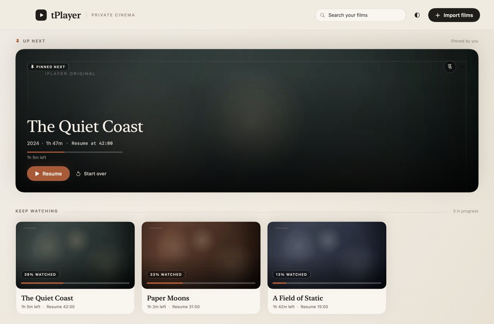
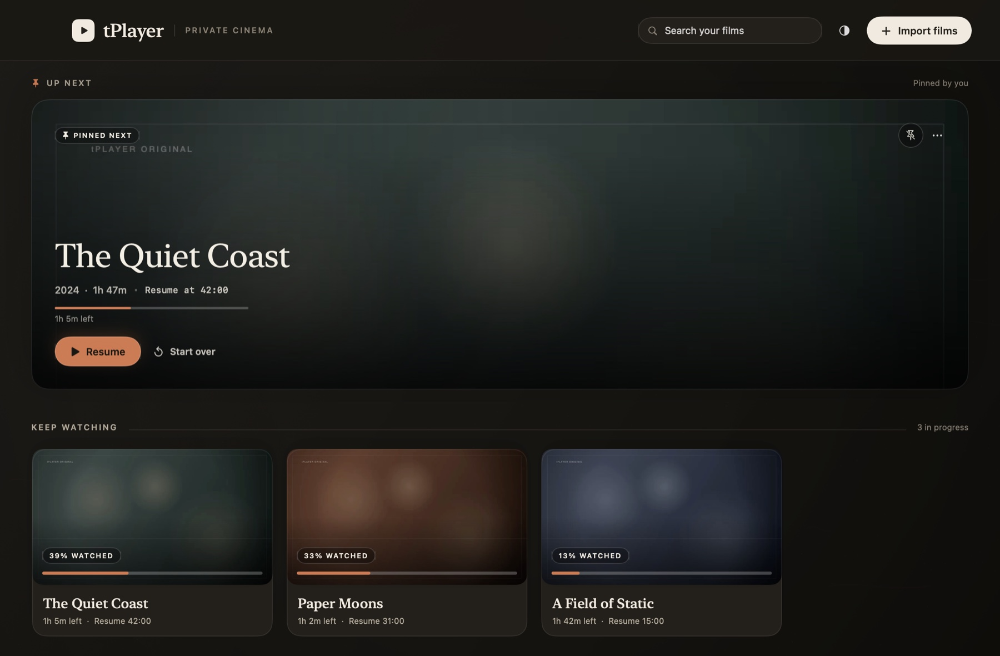
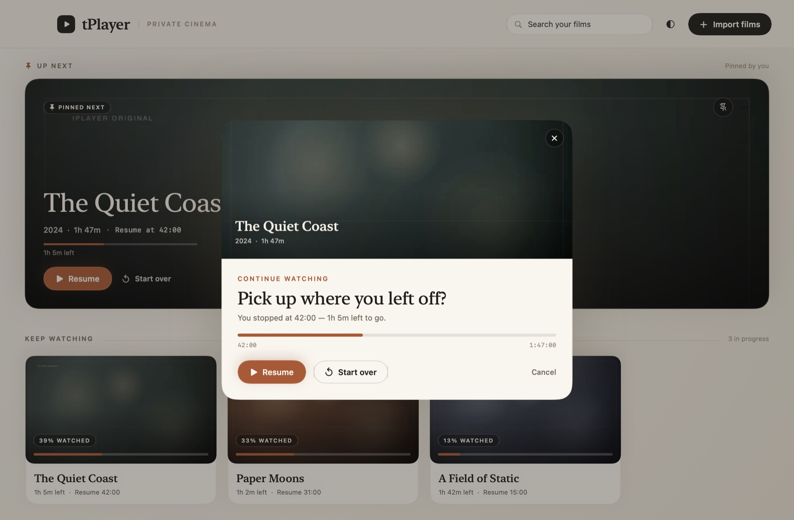
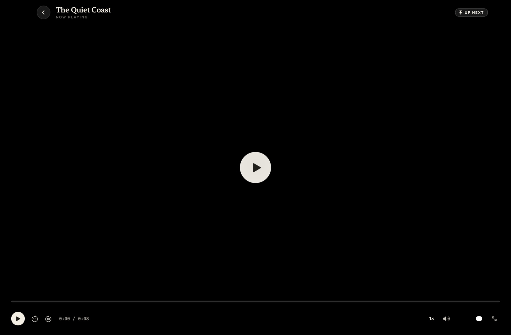

# tPlayer

A calm, local-first film library and player for macOS. Point it at your own
video files — it keeps them together, remembers where you stopped, and stays
out of the way.



<details>
<summary>Dark mode</summary>



</details>

## Features

- **Your files, your library.** Import MP4, M4V and MOV files with the Import
  button, by dragging them onto the window, or by opening them from Finder.
  Files are copied into the app's library folder so the originals stay where
  they are.
- **Pick up where you left off.** Playback position is saved as you watch.
  Films in progress appear under *Keep Watching*, and opening one asks whether
  to resume or start over.
- **Up next.** Pin a single film to the top of the home page as your next watch.
- **Automatic artwork.** A frame is grabbed from each film on import and cached
  as its thumbnail. Titles and years are inferred from the filename, and can be
  corrected with *Rename*.
- **A player that stays out of the way.** Space to play or pause, left and right
  to seek ten seconds, up and down for volume, `F` for fullscreen, `Esc` to
  leave.
- **Light and dark.** Follow the system, or pin the app to either appearance
  from the header.
- **Nothing leaves your Mac.** No accounts, no network requests, no telemetry.
  The library is a plain JSON file you can read, back up, or delete.



## The player

Playback fills the window, with the controls fading away while you watch. The
top bar returns on mouse movement, and every action has a key.



## Requirements

- macOS 14 Sonoma or later
- Xcode 16 or later to build from source

## Build

The repository ships a generated Xcode project, so you can open it directly:

```sh
open tPlayer.xcodeproj
```

Then run the `tPlayer` scheme. To build a release copy from the command line:

```sh
xcodebuild -project tPlayer.xcodeproj \
           -scheme tPlayer \
           -configuration Release \
           -derivedDataPath .build-release \
           build
```

The app is ad-hoc signed (`CODE_SIGN_IDENTITY = "-"`), which is enough to run it
on the machine that built it. To distribute a build, set your own signing team
in `project.yml` and regenerate the project.

`project.yml` is the source of truth for project settings. If you change it,
regenerate the Xcode project with [XcodeGen](https://github.com/yonaskolb/XcodeGen):

```sh
brew install xcodegen
xcodegen generate
```

## Where things live

Everything the app creates stays under one folder:

```
~/Library/Application Support/tPlayer/
├── library.json      # film metadata and playback positions
├── Media/            # imported video files
└── Thumbnails/       # cached artwork
```

*tPlayer → Reveal Library Folder* in the menu bar opens it in Finder. Deleting
the folder resets the app to an empty library.

## Project layout

```
tPlayer/
├── Models/       Film, library paths, and shared value types
├── Services/     Importing, persistence, thumbnails, filename parsing
├── Theme/        Palette, typography, and shared controls
├── Views/        Home, player, and overlay UI
└── Assets.xcassets
Tools/            Developer utilities (not part of the app)
```

`Tools/` contains small standalone scripts used while building the app:
`make_samples.swift` generates demo footage, `Snapshot` renders views to PNG
offscreen, `AX` drives the running app through the accessibility API, and
`make_icon.swift` draws the app icon. None of them are compiled into tPlayer.

## License

[MIT](LICENSE)
